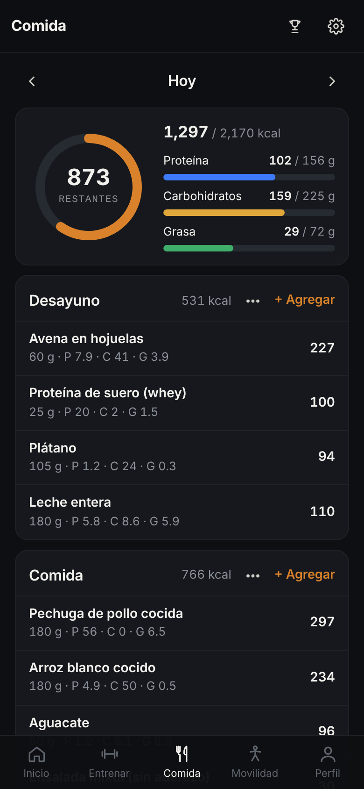
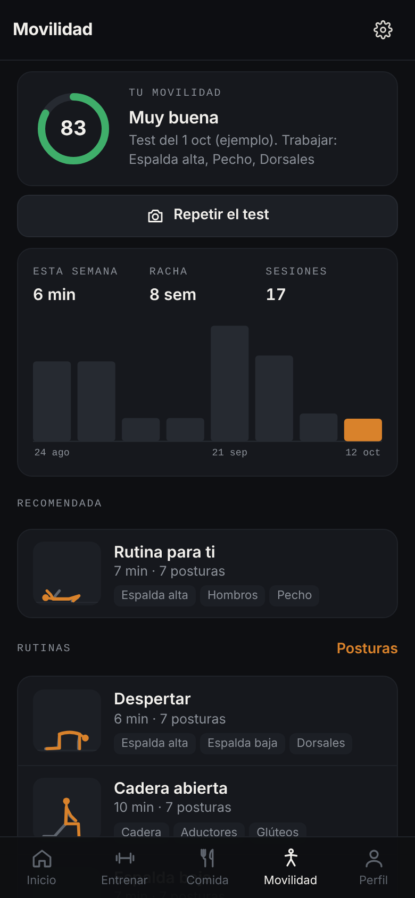
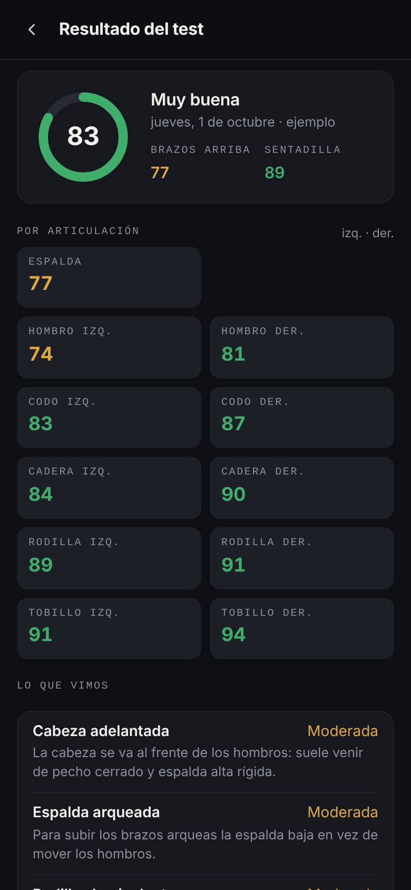

  
  
  
  

**Lo que no se anota, no se supera.**

Tres apps en una: **gym** (tipo Hevy), **comida** con gasto adaptativo (tipo MacroFactor) y
**movilidad** guiada con test por cámara (tipo Pliability). Sin backend ni cuenta: todo vive en el
teléfono. Se instala como **APK de Android** o se abre desde el link y se agrega a la pantalla de
inicio; funciona sin internet.

## Instalar

| | |
|---|---|
| **Android (APK)** | Descarga [`apk/Serie.apk`](apk/Serie.apk) en el teléfono, ábrelo y permite «instalar apps de origen desconocido» cuando lo pida. Cada push a `main` compila uno nuevo en *Releases* (GitHub Actions). |
| **Web** | Abre el link de la app y en el menú del navegador elige «Agregar a pantalla de inicio». |

  
  
  

  
  
  

---

## Qué hace

### Comida

| | |
|---|---|
| **Registro diario** | Desayuno, comida, cena y colaciones; anillo de calorías restantes y barras de proteína, carbohidratos y grasa. |
| **Alimentos** | Base propia de ~170 alimentos comunes en México (por 100 g, con porción típica), búsqueda sin acentos, recientes, favoritos, alimentos propios, comidas guardadas, registro rápido y copiar el día anterior. |
| **Código de barras** | Escanea con la cámara (o escribe el número) y busca en Open Food Facts; lo encontrado queda guardado para usarse sin internet. |
| **Peso de tendencia** | Media móvil exponencial que filtra agua y comida del día. |
| **Gasto adaptativo** | Calorías registradas menos la pendiente del peso × 7700 kcal/kg, en una ventana de 28 días; arranca con Mifflin-St Jeor. |
| **Check-in semanal** | Recalcula metas con el gasto real, tu objetivo (perder, mantener, ganar) y el ritmo elegido. |

### Movilidad

| | |
|---|---|
| **Rutinas guiadas** | 12 rutinas (cadera, espalda baja, hombros, después de pierna/empuje/jalón, para correr, antes de dormir…) y las tuyas. 36 posturas con ilustración e instrucciones. |
| **Reproductor** | Preparación, temporizador por postura, cambio de lado automático, voz en español, sonidos de conteo y pantalla encendida. |
| **Recomendada** | Arma una rutina con las zonas de tu último entreno y de tu último test. |
| **Test con cámara** | Brazos arriba y sentadilla, de frente y de cada lado. MediaPipe detecta la pose en el teléfono (no se envía video), calcula compensaciones y da un puntaje por articulación y las zonas a trabajar. |

### Gym

| | |
|---|---|
| **Entreno en curso** | Cronómetro, volumen y series en vivo. Tabla por ejercicio: *Serie · Anterior · Peso · Reps · ✓*. Si dejas un campo vacío y marcas la serie, toma el objetivo de la rutina o lo de la vez pasada. |
| **Tipos de serie** | Calentamiento (C), normal (1, 2, 3…), al fallo (F) y drop set (D). Los calentamientos no cuentan en la numeración ni en la distribución muscular. |
| **RPE** | Al tocar el número de serie: esfuerzo percibido de 6 a 10, se muestra como `@8` y en la columna *Anterior*. |
| **Descanso automático** | Al marcar una serie arranca el temporizador del ejercicio: −15 / +15 / saltar, con sonido y vibración al terminar. |
| **Récords en vivo** | Peso máximo, 1RM estimado (tabla porcentual) y mejor serie; los calentamientos no cuentan. Avisa en el momento en que los rompes; la primera vez que haces un ejercicio no cuenta como récord. |
| **Rutinas** | Crear, editar, duplicar, eliminar. Las series de la rutina se vuelven el objetivo (texto gris) al empezarla. Las reps aceptan rango (`8-12`). Cualquier entreno se puede repetir o guardar como rutina. |
| **Biblioteca** | 70 ejercicios en español con músculo principal, secundarios y equipo; búsqueda sin acentos, filtro por músculo, “más usados” y ejercicios personalizados. |
| **Herramientas** | Calentamiento automático (40/60/80 % × 5/5/3), reemplazar ejercicio, calculadora de discos, superseries, notas por ejercicio, tabla de repeticiones máximas. |
| **Progreso** | Gráfica de 12 semanas (duración, volumen o series), calendario, series por músculo en 30 días, racha semanal, peso corporal. |
| **Datos** | kg o lb, respaldo JSON (exportar/importar), exportación de series en CSV. |

Los tipos de ejercicio cubren peso y reps, peso corporal con lastre, asistido, solo reps, peso y
duración, duración y distancia con tiempo. El volumen sigue las reglas de la app de referencia: suma tu
peso corporal en dominadas y fondos, resta la asistencia y no cuenta calentamientos.

## Cómo se armó

El análisis está en [`docs/ANALISIS.md`](docs/ANALISIS.md): se inspeccionó el APK de la app de
referencia con REA y `hermes-dec` para obtener las fórmulas reales (1RM, volumen, récords, duración de rutina), y cómo el modelo de datos de la app se alinea con la API
pública de referencia. **No se copió código, textos, imágenes ni marca de ninguna app**: se
reproduce el *comportamiento* con una implementación propia.

## Reglas que la app respeta

- **Marca propia.** La app se llama *Serie*; no usa nombre, logo, textos, videos ni bases de datos de terceros.
- **Sin red, salvo el escáner.** Ni fuentes, ni analítica, ni CDN. La única conexión es buscar un código de barras en Open Food Facts cuando tú lo pides.
- **Los datos son del usuario.** Todo vive en el teléfono; respaldo JSON con un toque (incluye comida y movilidad).
- **Primera vez con ejemplo.** Al abrir por primera vez se cargan 8 semanas de una rutina
  Empuje / Jalón / Pierna para que las gráficas tengan algo que mostrar. *Ajustes → Borrar todo*
  deja la app en blanco.

## Qué se toca al mantenerlo

| Archivo | Qué hay |
|---|---|
| `index.html` | Solo el esqueleto de la página y el orden de carga de los scripts. |
| `css/app.css` | Todos los estilos. |
| `js/core.js` | Núcleo: estado, formato, navegación, render, gráficas, hojas, sonido, respaldo, `A` y `HOOKS`. |
| `js/gym.js` | Gym: catálogo, series, récords, rutinas, entreno en curso, perfil y ajustes. |
| `js/foods.js` · `js/nutri.js` | Comida. |
| `js/poses.js` · `js/movil.js` | Movilidad. |
| `js/boot.js` | Arranque, después de cargar todos los módulos. |

| Símbolo | Qué controla |
|---|---|
| `LIB` | Catálogo de ejercicios: `[id, nombre, músculo, secundarios, equipo, tipo]`. |
| `MUSCLE` / `EQUIP` / `TYPE` | Etiquetas en español de músculos, equipo y tipos de ejercicio. |
| `MET` / `metsFor` | Qué cuenta como récord para cada tipo de ejercicio. |
| `VIEWS` | Una función por pantalla: `home`, `train`, `workout`, `routine`, `finish`, `wv`, `lib`, `ex`, `me`, `cfg`. |
| `A` | Todas las acciones; cada botón dice cuál usa con `data-a`. Cada módulo agrega las suyas con `Object.assign(A, …)`. |
| `seed()` | Los datos de ejemplo de la primera vez. |
| `BLANKS` / `SEEDS` / `TABS` / `HOOKS` | Cómo cada módulo agrega su estado, sus datos de ejemplo, su pestaña y sus ganchos (`reset`, `render`, `tick`, `boot`). |
| `js/foods.js` | Base de alimentos `[id, nombre, kcal, P, C, G, porción_g, porción, categoría]`. |
| `js/nutri.js` · `NUT` | Tendencia de peso, gasto adaptativo y metas. |
| `js/poses.js` | Posturas: zonas, segundos, instrucciones y figura (coordenadas de articulaciones). |
| `js/movil.js` · `ROUTINES`, `MT` | Rutinas; detección, medidas y puntaje del test de movilidad. |

## Publicar

- **Web:** GitHub Pages sirviendo la raíz de la rama. `sw.js` guarda la app para usarla sin internet.
- **APK:** `npm install && npm run apk` (requiere JDK 21 y el SDK de Android) deja el APK en
  `android/app/build/outputs/apk/release/`. Capacitor empaqueta los mismos archivos web (`npm run build` → `www/`).
  La voz y la pantalla encendida usan los plugins `text-to-speech` y `keep-awake` dentro del APK.
- **Firma:** `android/serie-release.jks` y `android/keystore.properties` están en el repo a propósito,
  para que cualquier compilación (local o Actions) firme igual y el APK nuevo se instale encima del
  anterior sin perder datos. Es una llave solo para esta app personal.

---

*La versión anterior de este repositorio (la maqueta “Constancia” para mudanzas) sigue en el
historial de git, en el commit `7b27b42`.*
