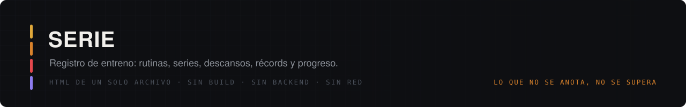
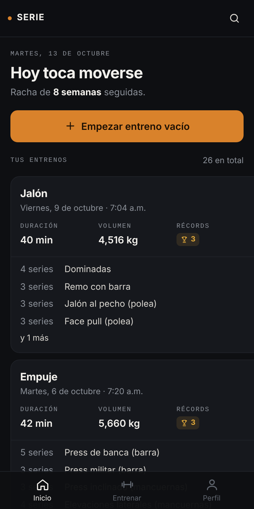
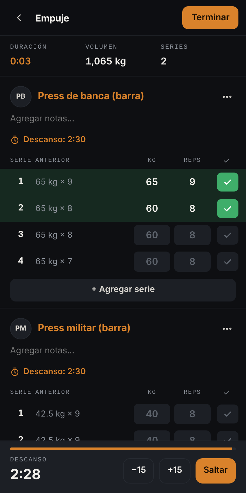
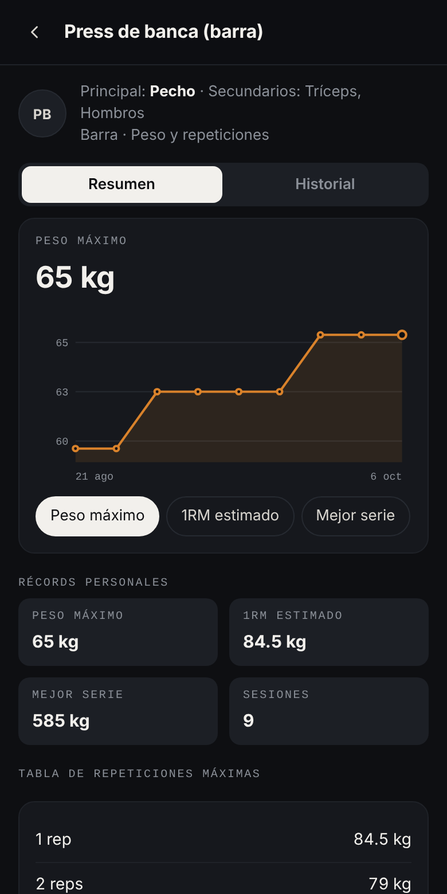

  
  
  
  

**Lo que no se anota, no se supera.**

Registro de entrenamiento de gimnasio inspirado en el flujo de las apps tipo *gym log*
(Hevy, Strong). Un solo archivo, `index.html`, sin build, sin backend, sin dependencias. Se abre
desde un link en el celular, se agrega a la pantalla de inicio y funciona sin internet.

  
  
  

---

## Qué hace

| | |
|---|---|
| **Entreno en curso** | Cronómetro, volumen y series en vivo. Tabla por ejercicio: *Serie · Anterior · Peso · Reps · ✓*. Si dejas un campo vacío y marcas la serie, toma el objetivo de la rutina o lo de la vez pasada. |
| **Tipos de serie** | Calentamiento (C), normal (1, 2, 3…), al fallo (F) y drop set (D). Los calentamientos no cuentan en la numeración ni en la distribución muscular. |
| **RPE** | Al tocar el número de serie: esfuerzo percibido de 6 a 10, se muestra como `@8` y en la columna *Anterior*. |
| **Descanso automático** | Al marcar una serie arranca el temporizador del ejercicio: −15 / +15 / saltar, con sonido y vibración al terminar. |
| **Récords en vivo** | Peso máximo, 1RM estimado (tabla porcentual) y mejor serie; los calentamientos no cuentan. Avisa en el momento en que los rompes; la primera vez que haces un ejercicio no cuenta como récord. |
| **Rutinas** | Crear, editar, duplicar, eliminar. Las series de la rutina se vuelven el objetivo (texto gris) al empezarla. Las reps aceptan rango (`8-12`). Cualquier entreno se puede repetir o guardar como rutina. |
| **Biblioteca** | 70 ejercicios en español con músculo principal, secundarios y equipo; búsqueda sin acentos, filtro por músculo, “más usados” y ejercicios personalizados. |
| **Herramientas** | Calentamiento automático (40/60/80 % × 5/5/3), reemplazar ejercicio, calculadora de discos, superseries, notas por ejercicio, tabla de repeticiones máximas. |
| **Progreso** | Gráfica de 12 semanas (duración, volumen o series), calendario, series por músculo en 30 días, racha semanal, peso corporal. |
| **Datos** | kg o lb, respaldo JSON (exportar/importar), exportación de series en CSV. |

Los tipos de ejercicio cubren peso y reps, peso corporal con lastre, asistido, solo reps, peso y
duración, duración y distancia con tiempo. El volumen sigue las reglas de la app de referencia: suma tu
peso corporal en dominadas y fondos, resta la asistencia y no cuenta calentamientos.

## Cómo se armó

El análisis está en [`docs/ANALISIS.md`](docs/ANALISIS.md): se inspeccionó el APK de la app de
referencia con REA y `hermes-dec` para obtener las fórmulas reales (1RM, volumen, récords, duración de rutina), y cómo el modelo de datos de la app se alinea con la API
pública de referencia. **No se copió código, textos, imágenes ni marca de ninguna app**: se
reproduce el *comportamiento* con una implementación propia.

## Reglas que el archivo respeta

- **Marca propia.** La app se llama *Serie*; no usa nombre, logo ni recursos de terceros.
- **Cero llamadas de red.** Ni fuentes, ni analítica, ni CDN.
- **Los datos son del usuario.** Todo vive en `localStorage` del navegador; respaldo con un toque.
- **Primera vez con ejemplo.** Al abrir por primera vez se cargan 8 semanas de una rutina
  Empuje / Jalón / Pierna para que las gráficas tengan algo que mostrar. *Ajustes → Borrar todo*
  deja la app en blanco.

## Qué se toca al mantenerlo

| Símbolo | Qué controla |
|---|---|
| `LIB` | Catálogo de ejercicios: `[id, nombre, músculo, secundarios, equipo, tipo]`. |
| `MUSCLE` / `EQUIP` / `TYPE` | Etiquetas en español de músculos, equipo y tipos de ejercicio. |
| `MET` / `metsFor` | Qué cuenta como récord para cada tipo de ejercicio. |
| `VIEWS` | Una función por pantalla: `home`, `train`, `workout`, `routine`, `finish`, `wv`, `lib`, `ex`, `me`, `cfg`. |
| `A` | Todas las acciones; cada botón dice cuál usa con `data-a`. |
| `seed()` | Los datos de ejemplo de la primera vez. |

## Publicar

GitHub Pages sirviendo la raíz de la rama. `index.html` está en la raíz, así que no hace falta
configuración adicional.

---

*La versión anterior de este repositorio (la maqueta “Constancia” para mudanzas) sigue en el
historial de git, en el commit `7b27b42`.*
